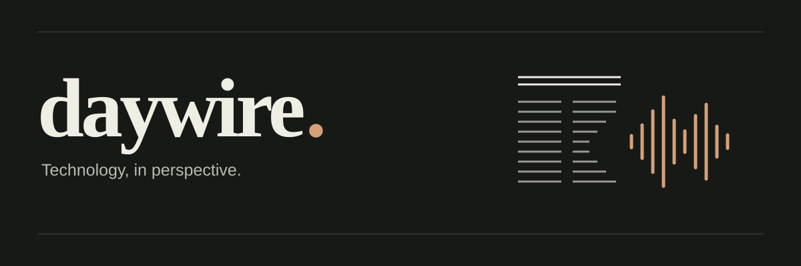

**[Read the newspaper](https://daywire.aditya-singh.in)** · **[Listen to the radio](https://daywire.aditya-singh.in/radio/)**

A daily technology newspaper with source-linked stories, two things to learn, a quick quiz, and a short radio bulletin. Built with **Go, Astro, Groq, and Kokoro**.

## How it works

Go collects stories from community feeds and engineering blogs. Groq writes and checks the edition against retrieved evidence, then creates a script for Kokoro to narrate. Astro renders structured JSON into the newspaper and radio pages.

GitHub Actions runs daily. Editions live on a dedicated content branch, audio lives in Cloudflare R2, and Vercel serves the site. Completed generation stages are cached so interrupted runs can resume.

## Run locally

Requires **Go 1.23+** and **Node.js 24**.

```sh
npm --prefix web ci
go run ./cmd/daywire demo
DAYWIRE_DEMO=1 npm --prefix web run dev
```

Open [localhost:4321](http://localhost:4321). The demo uses fictional stories and needs no API keys. See [.env.example](.env.example) for configuration and [config/sources.json](config/sources.json) for the source list.

## Checks

```sh
go test -race ./...
go vet ./...
npm --prefix web test
npm --prefix web run build
```

AI evals check the editorial verifier against frozen cases using the Groq API:

```sh
node scripts/daywire.mjs eval --dataset evals/development.json --out .daywire/eval-report.json
```

AI checks can miss errors. Original sources are linked beside each story.
